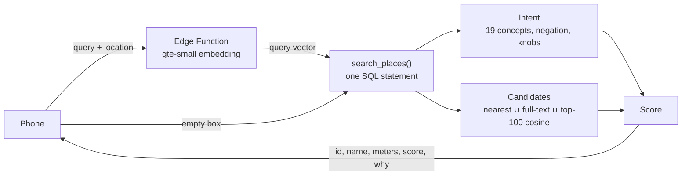

# Table

A restaurant app where you search by what you mean, not by keywords. You type *"cheap late night food near me"*, *"somewhere to cram for finals"* or *"I need caffeine"*, and you get a ranked list of nearby places that fits the sentence and fits you. Think Beli, but the search box actually understands you, and every result says why it's there.

This repo is a write-up, not the source. The code stays private for now, but I wanted a place to explain how it works and what went into it.

**Status:** iOS app (Expo / React Native) in active development, running against a live Supabase backend with ~700 real places from OpenStreetMap across two areas (UCLA/Westwood and Carmel Mountain Ranch in San Diego).

## What it does

- **Search by meaning.** Free-text queries go through one ranking function that blends what you asked for, who you are, and where you're standing. Each result comes back with a short reason ("late_night · near", "not spicy").
- **Recommendations with an empty box.** With nothing typed, the same function becomes a personal recommender: your taste, the place's quality, and distance.
- **Reviews without stars.** You rate by dragging a slider, and your own past places sit along the track as reference points, so every rating is relative to places you already know. The number is never shown. Reviews also carry chips (vibe, good for, tags) and short notes, which become the training data.
- **Your camera roll finds your visits.** The app reads photo locations, matches them to restaurants, and suggests the places you've been but haven't reviewed.

## How search works

Everything is scored on the server. The phone sends the query, its location and the user, and gets back about 3 KB of ranked rows. Vectors and model factors never leave Postgres.



**1. Intent.** A hand-built lexicon of 19 concepts (late night, date, cheap, study, quiet, groups, spicy, healthy, …) matched on stemmed text, plus knobs that reshape the ranker instead of adding relevance: "walking distance" makes distance cost 4x and caps the radius, "best" or "anniversary" doubles the weight on quality. "not / no / without X" flips a concept to negative. When no concept matches, the query embedding picks soft concept weights with a softmax over cosine similarities, each corrected by how similar that concept is to reviews in general (so broad concepts don't win every query). Words no concept claimed are treated as the food you asked for ("cheap tacos" → tacos).

**2. Candidates.** A union, so a text match can never push out a good nearby place: the nearest places (exact, see below), places whose full-text document matches the query (GIN index), and the 100 places most similar to the query by cosine.

**3. Score.** One formula in score units, so every weight means something:

```
score = prior + θ_u·φ_p + 0.05·z(x_u·y_p) − distance + β·relevance
```

- `prior`: a Bayesian average of the place's scores, centered on each reviewer's own mean, so a harsh and a generous rater count the same.
- `θ_u·φ_p`: **content taste.** Each place has a 19-dimension concept profile `φ` built from its chips, note text and cuisine. Each user's `θ` comes from a ridge regression of their scores on those profiles, pulled toward a prior, solved in closed form. A new user falls back to the non-personal model automatically.
- `x_u·y_p`: **implicit matrix factorization** (iALS, Hu–Koren–Volinsky) on which places people reviewed, with confidence weighted by score.
- `distance`: a pooled penalty per km learned from how scores fall off with distance (within place, so quality cancels out), shaped by the query.
- `relevance`: concept match, full-text rank, food match, and cosine to the place's embedding (its name, description and every review note).

A batch trainer fits all of it (profiles, ridge fits, ALS, embeddings) and writes four small tables. Request time is one SQL statement, 15–30 ms of execution.

## How I tested it

The ranking was researched before it was built. I wrote an evaluation harness with synthetic users and places that have **hidden ground-truth attributes and tastes**, which the models never see, then built models M0 to M5 and measured each one. Each model adds one idea:

| model | adds | personalization NDCG@10 | query NDCG@5 |
|---|---|---|---|
| M0 | nearest + rating | 0.678 | 0.441 |
| M1 | lexicon + full-text | 0.678 | 0.780 |
| M2 | content taste (ridge) | 0.799 | 0.781 |
| M3 | + implicit MF | **0.821** | 0.777 |
| M4 | + gte-small embeddings | 0.821 (empty query = M3) | **0.846** |

To keep myself honest:

- **Held-out queries.** A second set of 22 paraphrases was written *after* M4's weights were frozen. M4 still beats M3 there (0.791 vs 0.751), and cuts the share of irrelevant results in the top 5 from 18% to 14%. The held-out gain is about half the dev gain, which is the number I trust.
- **Live numbers, not just the harness.** After deploying, I re-ran every query against production for 30 synthetic users (2,640 calls, 0 errors): live M4 0.823 dev / 0.770 held-out. Live and local embeddings match to cosine ≥ 1 − 5e-7.
- **Things that didn't work are written down.** M5 learned a linear transform on top of the embeddings from simulated likes and saves. It won on validation queries but lost on held-out ones (0.760 vs 0.778): with 280 training queries from one author, it learned that author's phrasing, not meaning. It isn't shipped. The estimator mistakes it took to get a fair test (position bias absorbing the ranker, label leakage through user vectors, uncentered query vectors) are documented for when real data arrives.

## Bugs worth telling

- **Stopwords ate the meaning.** Postgres's `english` text config dropped "after" from "after hours", so any query containing "hours" turned into late night, and "close by" matched "closed". Fixed with a config that stems but keeps stopwords.
- **"cheap tacos" returned boba.** Concept profiles were z-scored over all 713 places, but only ~44 had reviews, so reviewed places reached z ≈ 10 and drowned the food match. Z-scoring over reviewed places plus a separate food term took mixed queries from 23/90 to 76/90 with the food in the top 5.
- **Nearest isn't nearest in degrees.** A GiST KNN index measures raw degrees, which overstates east-west distance by 1/cos(latitude). The nearby query takes the KNN result, widens the search radius by exactly that factor so every true top-N place is provably inside it, then sorts by real meters. Verified identical to a full sort on 66 live queries, at O(log N + k log k).

## Photo scan

Built for a 20,000-photo library on a phone:

1. A cache on the device holds every located photo; later scans only ask iOS for photos modified since the last one. The first scan of ~12,000 photos takes ~20 s, later ones read a handful.
2. Photos outside the area are dropped, identical coordinates collapse into one spot, and all spots go to the server in **one** request that returns every restaurant within 15 m of each, using a box query on the location index (12,000 synthetic photos: 0.3–0.9 s).
3. Photos at the same nearest restaurant on the same day become one visit. Places you've already reviewed are hidden.

## Data

- **Places** come from OpenStreetMap (Overpass, free and storable), seeded ahead of time; the app never calls Overpass. Neighborhoods come from Nominatim reverse geocoding, with a nearest-point rule so the Century City mall doesn't say Westwood.
- **Cold start.** A new place has no reviews, so an LLM batch job (OpenAI's Codex CLI) writes a keyword description (cuisine, dishes, format) and a price estimate for every place. That description is embedded and indexed, so places are findable by dish on day one.
- **Training data for a learned ranker** is already logged: every list shown, how far the user scrolled, every like and save with its list position, and how long each place page stayed open.

## Stack

- Expo SDK 57 (React Native, expo-router, TypeScript), iOS through Expo Go
- Supabase Postgres: pgvector (384-d gte-small), GIN full-text, GiST spatial index, the ranker as SQL functions
- Supabase Edge Function (Deno) running gte-small for query embeddings
- Node scripts for seeding, the nightly trainer and the evaluation harness (the harness and the trainer share the same model code, so what's measured is what ships)

## Why I built it

Choosing where to eat is rarely just "what cuisine do I want?" It depends on the moment: somewhere loud for a group, quiet enough to study, quick after class, cozy for a date or comforting at the end of a long day. Most food apps flatten that into star ratings and category filters, even though the vibe matters as much as the food. I built Table because semantic search should be able to capture the whole thought in your head—the mood, occasion, constraints and craving—and match it against what reviews say a place actually feels like. The goal isn't just to find good food; it's to find the place that fits *right now*.
