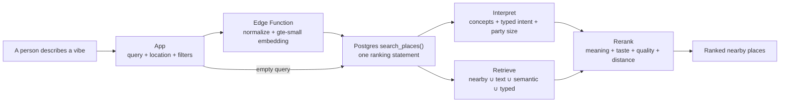

# Table

**One restaurant recommendation algorithm, with or without a search query.**

With an empty search box, Table recommends nearby places using community quality, learned content taste, matrix factorization and distance. When someone types *“cozy dessert spot for a date”* or *“quiet coffee shop to study,”* semantic search adds the meaning of that request to the same ranking—not a separate results system.

The result blends who the person is with what they want right now. Reviews teach the recommender both: ratings reveal personal taste, while notes and tags describe what a restaurant actually feels like.

This repo is a write-up, not the source. The app code stays private for now, but I wanted a place to explain the product, how the search works and how I tested it.

**Status:** iOS app (Expo / React Native) in active development, backed by a live Supabase database with more than 800 OpenStreetMap venues across the UCLA/Westwood area and Carmel Mountain Ranch in San Diego.

## Search for the moment

Table accepts the situation someone would normally say out loud:

- `somewhere quiet to study with coffee`
- `cheap late-night Chinese near me`
- `cozy dessert spot for a date`
- `a lively bar for 8 people`

The algorithm keeps price, moment, cuisine, distance, group size and atmosphere together instead of reducing the request to one keyword.

## From a vibe to a ranked list

When someone searches, Table does five things:

1. **Understands the request.** It identifies known ideas such as quiet, date night, groups, cheap, quick, spicy or late night while keeping the full sentence for semantic matching.
2. **Finds plausible places.** It gathers nearby restaurants, direct text matches, semantically similar places and matches from structured cuisine or venue data.
3. **Reads the place through its reviews.** Review notes, descriptions and tags form a searchable profile of what each place feels like and what it is good for.
4. **Adjusts for the person and the moment.** The ranker blends query relevance with the person's taste, community opinion, distance, price and group context.
5. **Returns one ordered list.** The strongest complete matches lead, but useful alternatives can remain when the data is incomplete or no place satisfies every part of the request.

That last point is intentional. Natural language is used as a preference, not a hidden set of hard filters. A request for `Chinese late night` should favor a place with evidence for both, but it should not return nothing just because opening-hours coverage is incomplete. Only the visible distance, price and **New to me** controls are hard filters.

## Why reviews matter

A directory can say that a place is a cafe. Reviews can say that it is calm on weekday afternoons, has outlets near the back wall, works for solo studying or becomes loud after 9.

Table reviews capture:

- a rating made relative to places the reviewer already knows;
- a note about the visit and a description of the place;
- **Vibe** tags such as cozy, lively, romantic, quiet or outdoor;
- **Recommended for** tags such as date night, groups, late night, studying or a quick bite;
- experience tags such as cheap, worth it, big portions, slow service or good drinks;
- optional photos and visit context.

The written review and tags do two jobs. They strengthen the restaurant's semantic profile, and they teach the recommender what that reviewer tends to like. Reviews are not a separate feed beside search; they are the evidence the search is built on.

## What the app does today

- **One query-aware recommender.** With text, semantic relevance reshapes the personal ranking; without it, matrix factorization, learned taste, quality and distance still recommend places.
- **Reviews without stars.** A slider shows the person's past restaurants as reference points, so every rating is relative to their own history. The numeric score is never shown.
- **Review-derived summaries.** Result rows and place pages show the tags and notes people associate with a restaurant.
- **Useful controls.** Filter by distance, price or places that are new to the user.
- **Photo-based visit discovery.** Scan photo locations to find restaurants the person likely visited but has not reviewed.
- **Saved places and likes.** Act on a result without leaving the list.
- **Accounts and review photos.** Upgrade anonymous use without losing activity, then attach photos from the scan, library or camera.

## Recent search improvements

The first version was mostly a concept lexicon, full-text search and embeddings. The current version adds more structure where semantic similarity alone is too fuzzy:

- **Typed cuisine and venue intent.** `Chinese`, `Sichuan`, `sushi` and `ramen` remain distinct instead of collapsing into a broad “Asian” match. An alcohol bar is also separated from a sushi bar or juice bar.
- **Soft constraints and negation.** Named cuisines and venue types add or subtract calibrated relevance. `Chinese not Japanese` can express both sides without deleting every alternative from the candidate set.
- **Party-size parsing.** `For 8 people` means eight; `with 8 friends` means nine including the user. Confirmed capacity helps, confirmed too-small capacity hurts and missing capacity stays neutral.
- **Stable equivalent phrasing.** Fully understood variations are canonicalized before lexical and embedding search, so `Chinese late night` and `late night Chinese` do not drift just because of word order.
- **Richer source facts.** The importer now preserves place type, hours, reservations, outdoor seating, accessibility, capacity, alcohol information and source timestamps when OpenStreetMap provides them.
- **Honest unknowns.** Raw hours are stored, but `open now` is not used as relevance until complete schedule, timezone and holiday parsing can support the claim. “Late night” currently comes from review and description evidence.

The live corpus is still uneven. Cuisine and venue type have useful coverage; exact capacity is rare. Unknown data is therefore neutral rather than silently treated as a match or a failure.

## How it works under the hood

Everything after the phone sends the query is scored on the server. Query vectors and model factors never leave Supabase.



### 1. Normalize only what is safe

The Edge Function canonicalizes requests only when the meaning is fully understood. Equivalent numeric and word forms share an embedding, as do commutative phrases such as `Chinese late night` and `late night Chinese`. Free-form, alternative and negated requests are left alone rather than being silently rewritten.

Unsupported availability language is removed from relevance. Until Table can correctly interpret weekly schedules, overnight hours, timezones and holiday exceptions, `open now` cannot pretend to be verified.

### 2. Separate intent from the remaining text

A 19-concept lexicon recognizes experiences such as late night, date, cheap, study, quiet, lively, groups, quick, solo, coffee, dessert, healthy, hearty, outdoor and drinks. Negation flips a matched concept instead of losing the word.

Structured parsers handle explicit cuisines, alcohol-venue language and party size. Words not claimed by a concept or parser become the food-specific part of the query: in `cheap tacos`, `cheap` shapes the concept score while `tacos` still has to match what the restaurant serves.

If no known concept explains the request, the query embedding softly activates the nearest concepts. This lets paraphrases work without forcing every sentence into a fixed vocabulary.

### 3. Retrieve a union of candidates

The candidate pool combines:

- the nearest places;
- full-text matches over restaurant and review documents;
- the places most similar to the query embedding;
- structured cuisine and venue-type matches.

It is a union, not a sequence of gates. A semantic match cannot remove a strong nearby option, and a sparse structured field cannot empty the result list.

### 4. Build restaurant and user profiles

Each restaurant gets:

- a searchable document made from its name, cuisine, description, review notes and review tags;
- a 384-dimensional `gte-small` embedding;
- a 19-dimensional concept profile built from chips, review language, cuisine and price;
- a quality prior that corrects for generous and harsh reviewers;
- a small collaborative-filtering factor learned from which places people reviewed.

Each user gets a taste vector learned by ridge regression over the profiles of places they rated, plus a collaborative-filtering factor and an individual distance sensitivity. A new user automatically falls back to community quality and distance instead of needing a separate cold-start path.

### 5. Rank everything together

The core score is:

```text
score = quality
      + personal concept taste
      + collaborative taste
      - distance cost
      + semantic and lexical relevance
      + typed cuisine, venue and party fit
```

In the implementation this is one Postgres statement:

```text
prior + θᵤ·φₚ + 0.05·z(xᵤ·yₚ) − distance + β·relevance + typed_fit
```

- `prior` is a Bayesian average centered on each reviewer's own mean, so generous and harsh raters count comparably.
- `θᵤ·φₚ` is content taste: what this user tends to like about a place.
- `xᵤ·yₚ` is implicit matrix factorization over which places people reviewed.
- `distance` is learned from how ratings change with travel distance, then reshaped by phrases such as `near me` and by the distance slider.
- `relevance` blends concept fit, full-text rank, food-specific matching and cosine similarity to the place embedding.
- `typed_fit` adds bounded evidence for cuisine, venue type and known party capacity.

The weights stay in rating-score units so a query feature can be compared with quality, taste and distance instead of becoming an arbitrary second ranking system.

## How I tested it

I built the evaluation harness before the production ranker. Synthetic users and places contain hidden attributes and tastes that the models never see, which makes it possible to measure whether each added idea actually recovers the truth.

| model | adds | personalization NDCG@10 | query NDCG@5 |
| --- | --- | ---: | ---: |
| M0 | nearest + rating | 0.678 | 0.441 |
| M1 | lexicon + full-text | 0.678 | 0.780 |
| M2 | content taste (ridge) | 0.799 | 0.781 |
| M3 | + implicit MF | **0.821** | 0.777 |
| M4 | + `gte-small` embeddings | 0.821 (empty query = M3) | **0.846** |

The embedding model was also tested on 22 paraphrases written after its weights were frozen. It beat the non-embedding model there too (0.791 vs. 0.751) and reduced irrelevant top-five results from 18% to 14%. The held-out gain is smaller than the development gain, which is the number I trust.

The newer explicit-intent suite tests cuisines, bars, party wording, alternatives, exclusions and unsupported `open now` phrasing against the live corpus. The current soft-ranking policy passes 16 of 18 primary preference checks. Four families of equivalent queries have 1.00 top-ten set and prefix agreement, including word-order changes and numeric-versus-written party sizes.

Those results are reported with coverage. For example, Table can measure cuisine behavior across many labeled venues, but it cannot claim that a place seats eight when capacity exists for only a handful of records.

## Bugs and failures worth telling

- **Stopwords ate the meaning.** Postgres's default English configuration dropped `after` from `after hours`, and `close by` collided with `closed`. A custom configuration now stems words while preserving stopwords.
- **“Cheap tacos” returned boba.** Concept profiles were standardized over hundreds of mostly unreviewed places, causing the reviewed subset to overwhelm the food match. Standardizing over reviewed places and separating the remaining food terms moved mixed-query success from 23/90 to 76/90.
- **A bar was not always a bar.** Plain text treated sushi bars, salad bars and juice bars like alcohol venues. Venue-type relevance now requires structured or exact factual evidence.
- **Equivalent sentences drifted.** Embeddings for `bar for eight people` and `bar for 8` were close but not identical, which needlessly changed the order. Conservative canonicalization now gives fully understood equivalents one representation.
- **Nearest was not nearest in degrees.** A geographic KNN index measures raw latitude and longitude degrees, overstating east-west distance. The nearby query widens the indexed search by the exact latitude correction and then sorts by real meters; it matched a full sort on all 66 verification queries.
- **The learned embedding transform overfit.** A fifth model trained on simulated likes and saves won on validation and lost on held-out queries. It learned the author's phrasing rather than meaning, so it is not shipped.

## The newest review-retrieval finding

A recent diagnostic asked 26 questions whose answers appeared inside 23 real reviews. It exposed a pipeline problem before a model problem: a new or edited review clears its old vector, but the current batch trainer has to run before search can use the new text.

Simulating that refresh moved `gte-small` top-five retrieval from 15.4% to 92.3%. Comparing the query with individual review passages reached 96.2%, and a MiniLM-L6 reranker improved ordering further. Those labels were deliberately derived from the same reviews, so this is a retrieval diagnostic, not an unbiased product-quality benchmark.

The next search change is event-driven indexing after every review save, while keeping the full batch job for periodic taste and collaborative-factor training. A small review-level reranker is promising but is not shipped yet. Spelling correction is separate work; neither embeddings nor reranking reliably turned `booba` back into `boba`.

## Photo scan

The visit scanner was built for a phone with a 20,000-photo library:

1. A device cache holds every located photo; later scans ask iOS only for photos changed since the last scan.
2. Photos outside supported areas are discarded, identical coordinates collapse into one spot and all spots are matched in one server request.
3. Nearby photos at the same restaurant on the same day become one visit. Reviewed and dismissed visits stay hidden on later scans.

The first scan of about 12,000 located photos takes roughly 20 seconds on the test phone; later scans usually process only a handful. A 12,000-photo synthetic server match takes about 0.3–0.9 seconds.

## Data

- **Places** come from OpenStreetMap through Overpass and are seeded into Supabase. The app never calls Overpass directly.
- **Structured source facts** are stored separately from curated descriptions so re-importing OpenStreetMap does not overwrite editorial text.
- **Cold start** uses source facts plus a generated cuisine/dish/format description and price estimate, making a new place searchable before it has reviews.
- **Unknown stays unknown.** The system does not manufacture hours, capacity, accessibility or review evidence to fill gaps.
- **Learning signals** are already recorded: ordered result lists, scroll depth, likes, saves, place-page time and reviews. These are for evaluating a future learned ranker; the overfit embedding transform is not in production.

## Stack

- Expo SDK 57, React Native, Expo Router and TypeScript
- Supabase Postgres with `pgvector`, GIN full-text search, a GiST spatial index and row-level security
- Supabase Edge Functions running `gte-small` for query and document embeddings
- Node scripts for OpenStreetMap seeding, enrichment, nightly training and the evaluation harness
- One shared model implementation between the harness and trainer, so the algorithm measured offline is the one written to production tables

## Why I built it

Choosing where to eat is rarely just “what cuisine do I want?” It depends on the moment: somewhere loud for a group, quiet enough to study, quick after class, cozy for a date or comforting at the end of a long day. Most food apps flatten that into star ratings and category filters, even though the vibe matters as much as the food. I built Table because semantic search should be able to capture the whole thought in your head—the mood, occasion, constraints and craving—and match it against what reviews say a place actually feels like. The goal is not just to find good food; it is to find the place that fits *right now*.
