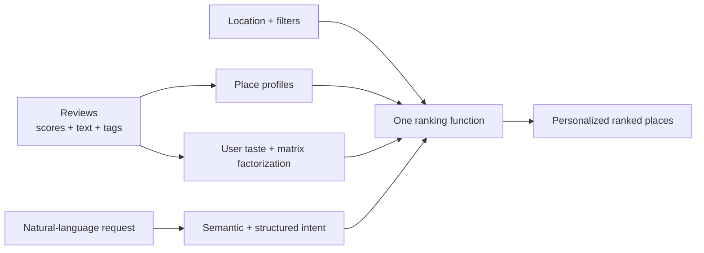

# Table

**Personalized restaurant recommendations from taste and intent.**

Table combines content-based taste modeling, implicit matrix factorization and semantic search in one ranking function. Review scores and interactions model the user; review text and tags model each restaurant. A natural-language request such as `quiet coffee shop to study` adds the user's current intent to that personalized ranking alongside quality and distance.

This repo explains the system; the app source is private.

**Status:** iOS app (Expo / React Native) in active development, backed by Supabase and more than 800 OpenStreetMap venues across UCLA/Westwood and Carmel Mountain Ranch in San Diego.

## Recommendation inputs

Each restaurant is scored from:

- **Personal taste:** what this person tends to enjoy, learned from their reviews.
- **Shared behavior:** patterns between people and places, learned with matrix factorization.
- **Current intent:** semantic, lexical and structured relevance to the user's request.
- **Place quality:** community ratings adjusted for different rating habits and small sample sizes.
- **Context:** distance, price, group size and explicit app filters.

The request can describe a vibe, craving, cuisine, occasion or constraint. It changes the recommendation score without replacing the personal taste and collaborative signals.

## Example query

Suppose someone searches:

```text
cheap late-night Chinese near me
```

Table reads several things in the same sentence:

- `cheap` describes price and value;
- `late-night` describes the occasion and expected experience;
- `Chinese` names a cuisine;
- `near me` increases the cost of distance;
- the full sentence supplies a semantic embedding that can match related review language and paraphrases.

It then gathers nearby, lexical, semantic and cuisine-matched candidates. Each candidate is scored for query fit, personal taste, community quality and distance. A strong match for every part should lead, while useful alternatives remain available when no restaurant has evidence for the entire request.

Natural-language intent is deliberately soft. It influences order rather than silently acting as a filter. Only the visible distance, price and **New to me** controls are hard filters.

## Reviews power the model

A place listing may say that a restaurant is a cafe. Reviews can say that it is quiet in the afternoon, good for solo work, crowded after 9 or worth the walk for large portions.

Each Table review can include:

- a rating made relative to restaurants the reviewer already knows;
- a note about the visit and a description of the place;
- vibe tags such as cozy, lively, romantic, quiet or outdoor;
- occasion tags such as date night, groups, late night, studying or a quick bite;
- experience tags such as cheap, worth it, big portions, slow service or good drinks;
- optional photos and visit context.

The same review improves multiple parts of the system. Its score teaches the personal taste model. The interaction contributes to matrix factorization. Its words and tags strengthen the restaurant's searchable profile. Reviews are therefore both product content and model data.

## What the app does today

- Ranks nearby restaurants for each person using learned taste, matrix factorization, quality and distance.
- Accepts natural-language requests that reshape those recommendations through semantic search.
- Lets people rate restaurants on a benchmark slider against their own review history instead of using visible stars.
- Shows review-derived tags and recent notes on results and place pages.
- Filters by distance, price or places the person has not reviewed.
- Finds likely past visits from photo locations, then lets the person review or dismiss them.
- Supports likes, saved places, accounts and photos from the scan, library or camera.

## How the recommendation system works

Everything is scored on the server. The phone sends the request, location, user and filters; query vectors and model factors stay in Supabase.



### Place profiles

Each restaurant has four main representations:

1. A searchable document made from its name, cuisine, description, review notes and tags.
2. A 384-dimensional `gte-small` embedding built from its descriptive text and reviews.
3. A 19-dimensional concept profile covering ideas such as quiet, study, date night, cheap, groups, spicy, healthy, late night and drinks.
4. Collaborative and quality terms learned from review behavior and scores.

The concept profile provides interpretable evidence. The embedding handles phrasing that the fixed concept vocabulary does not anticipate. Full-text and structured fields preserve precision for restaurant names, dishes, cuisines and venue types.

### User profiles

Personalization combines two views of taste:

- **Content taste:** ridge regression learns which place concepts predict this person's ratings. This captures preferences that can be explained, such as liking quiet cafes or disliking expensive restaurants.
- **Collaborative taste:** implicit matrix factorization learns from which places people reviewed, with confidence weighted by their scores. This can connect users and restaurants even when the relationship is not captured by a named concept.

The two methods complement each other. Content features explain *why* a place may fit; matrix factorization captures patterns the hand-built features miss. A new user falls back to community quality and distance until their reviews provide enough personal evidence.

### Query understanding

The request is embedded with `gte-small`, but embeddings are not trusted to do everything.

A concept lexicon recognizes common restaurant intents and negation. Structured parsers identify named cuisines, alcohol venues and party sizes. Words not claimed by those parsers remain available for food-specific matching, so `cheap tacos` still has to match tacos rather than only cheap places.

When the request falls outside the known vocabulary, semantic similarity still contributes directly and can softly activate related concepts. This lets the model accept free-form requests without pretending every sentence can be reduced to a fixed set of labels.

### Candidate retrieval

The candidate set is a union of:

- nearby restaurants;
- full-text matches;
- the most semantically similar place profiles;
- structured cuisine and venue-type matches.

Using a union matters. Semantic retrieval cannot remove a strong nearby recommendation, and missing structured data cannot empty the result list.

### Ranking

Every candidate is scored by one Postgres function:

```text
score = quality
      + content taste
      + collaborative taste
      - distance cost
      + query relevance
      + structured intent fit
```

The implementation is approximately:

```text
prior + θᵤ·φₚ + 0.05·z(xᵤ·yₚ) − distance + β·relevance + typed_fit
```

- `prior` is a Bayesian quality estimate centered on each reviewer's average, so harsh and generous raters count comparably.
- `θᵤ·φₚ` is the match between the user's learned content taste and the restaurant's concept profile.
- `xᵤ·yₚ` is the matrix-factorization signal.
- `distance` is learned from rating behavior, then adjusted by the request and distance slider.
- `relevance` blends concepts, full-text rank, food matching and embedding similarity.
- `typed_fit` adds bounded evidence for cuisine, venue type and known party capacity.

The query changes the relevance and context terms without discarding the recommendation terms. That is the central design: semantic search and collaborative recommendation contribute to the same score.

## Recent improvements

Semantic similarity is useful but too fuzzy for some explicit requests, so the current ranker adds structure where precision matters:

- `Chinese`, `Sichuan`, `sushi` and `ramen` stay distinct instead of collapsing into “Asian.”
- An alcohol bar is distinguished from a sushi bar, juice bar or salad bar.
- Negated intent subtracts relevance, allowing requests such as `Chinese not Japanese`.
- Party language is parsed: `for 8 people` means eight, while `with 8 friends` means nine including the user.
- Equivalent understood phrasing is normalized before embedding, so word order and written numbers do not needlessly change results.
- The importer now preserves source facts such as place type, hours, reservations, outdoor seating, accessibility, capacity and alcohol information.

Unknown evidence remains neutral. For example, exact capacity is available for very few venues, so Table cannot promise that a restaurant seats eight. Raw hours are stored, but `open now` is intentionally excluded from relevance until schedule, timezone and holiday parsing can support the claim.

## Evaluation

I built the evaluation harness before the production ranker. Synthetic users and restaurants contain hidden tastes and attributes that the models never see, making it possible to measure what each model recovers.

| model | adds | personalization NDCG@10 | query NDCG@5 |
| --- | --- | ---: | ---: |
| M0 | nearest + rating | 0.678 | 0.441 |
| M1 | lexicon + full-text | 0.678 | 0.780 |
| M2 | content taste | 0.799 | 0.781 |
| M3 | + implicit matrix factorization | **0.821** | 0.777 |
| M4 | + `gte-small` semantic search | 0.821 | **0.846** |

M3 is the recommendation model used when there is no request. M4 adds semantic query relevance without changing the underlying personalized ranking.

On 22 paraphrases written after the weights were frozen, M4 beat M3 by 0.791 to 0.751 and reduced irrelevant top-five results from 18% to 14%. The smaller held-out gain is the result I trust.

A newer production suite covers cuisines, bars, party wording, alternatives, exclusions and unsupported `open now` language. The current soft-ranking policy passes 16 of 18 primary checks. Equivalent word-order and party-size phrasings produce identical top-ten sets and prefixes in the tested families.

Coverage is reported alongside performance. Cuisine behavior can be measured across many venues; exact eight-person fit cannot be validated when almost no source records contain capacity.

## Failures that changed the design

- **Stopwords changed intent.** Postgres dropped `after` from `after hours`, while `close by` collided with `closed`. A custom text configuration now stems words without discarding stopwords.
- **“Cheap tacos” returned boba.** Reviewed places were over-standardized and overwhelmed the food match. Separating remaining food terms and correcting the reference population moved mixed-query success from 23/90 to 76/90.
- **A bar was not always a bar.** Plain text matched sushi bars and juice bars as alcohol venues. Venue intent now requires structured or exact factual evidence.
- **Equivalent sentences drifted.** Similar embeddings still changed the order for `bar for 8` and `bar for eight people`. Conservative normalization now gives fully understood equivalents the same representation.
- **A learned embedding transform overfit.** It improved validation results and lost on held-out queries, so it is not shipped.

## Fresh-review retrieval

A recent 26-query diagnostic found that fresh reviews can wait for the batch trainer before becoming searchable. That is an indexing problem: a retrieval model cannot use text it has not received.

Simulating an immediate refresh moved `gte-small` top-five retrieval from 15.4% to 92.3%. Comparing against individual review passages reached 96.2%, and a MiniLM-L6 reranker improved the ordering further. Because the questions were deliberately written from those reviews, this is a retrieval diagnostic rather than an unbiased product benchmark.

The next step is event-driven indexing after each review save. The full batch trainer will remain responsible for periodic taste and matrix-factorization updates. The review-level reranker is promising but not yet shipped.

## Photo scan

The visit scanner was designed for a 20,000-photo library. Located photos are cached on the phone, later scans fetch only changes and repeated coordinates collapse into one point before matching. Photos at the same nearby restaurant on the same day become one visit; reviewed and dismissed visits stay hidden.

The first scan of roughly 12,000 photos takes about 20 seconds on the test phone. Later scans usually process only a handful, while a 12,000-photo synthetic server match takes 0.3–0.9 seconds.

## Data and stack

- Expo SDK 57, React Native, Expo Router and TypeScript
- Supabase Postgres with `pgvector`, GIN full-text search, a GiST spatial index and row-level security
- Supabase Edge Functions running `gte-small`
- OpenStreetMap place data imported through Overpass; the app never calls Overpass directly
- Separate structured source facts and curated descriptions, so enrichment does not overwrite source data
- Node scripts for seeding, enrichment, training and evaluation

New restaurants receive a source-backed description and price estimate so they are searchable before reviews arrive. Unknown hours, capacity, accessibility and review evidence are never invented to fill gaps.

## Why I built it

Choosing where to eat is rarely just “what cuisine do I want?” It depends on the moment: somewhere loud for a group, quiet enough to study, quick after class, cozy for a date or comforting after a long day. I built Table because a recommendation system should understand both the person and that moment. Matrix factorization can learn patterns in taste, while semantic search can express what those patterns alone cannot: what someone wants *right now*.
